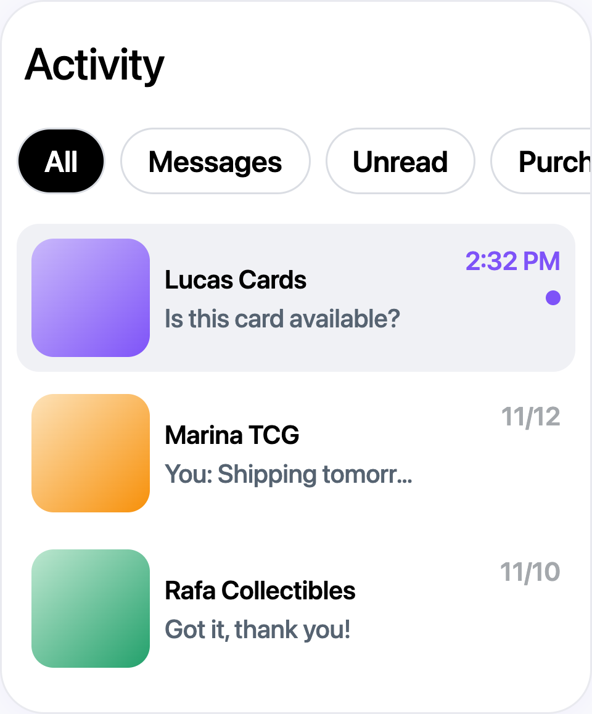

# Direct Messages for Sellers

## What you'll learn

This guide explains how direct messages (DMs) work for sellers on Jamble. You'll learn how to access your messages, communicate with buyers about products and orders, send photos, and organize your inbox. DMs are your main channel for communicating with buyers outside of lives.

## Before you start

You need:
- An approved seller account on Jamble

## Where to find your messages

All your conversations are in the **Activity** tab, one of the main tabs at the bottom of your screen. At the top of the Activity screen you see the filters and, right below, your conversation list:

The **All** filter is selected by default. A conversation with a new message shows a **gray background**, a purple time and a **purple dot** on the right.

Swipe the filters sideways to see all of them:

- **All**: every conversation you have
- **Messages**: conversations that are not about an order, such as questions and offers about your products
- **Unread**: conversations with new messages you haven't read yet
- **Purchases**: conversations about orders you bought from other sellers
- **Sales**: conversations about orders you sold
- **Archived**: conversations you've archived

As a seller, use **Messages** to answer questions before a purchase and **Sales** to follow orders that were already placed.

To find a specific conversation, tap the **magnifying glass** at the top of the Activity screen and search by name, product, order number or message.

## Types of conversations

Not all conversations look the same. There are three types:

### Direct messages

When someone taps **Message** on your profile, it opens a simple conversation between the two of you, with no product or order attached.

### Product conversations

When a buyer messages you from one of your shop products, or makes an offer on a product, the conversation shows **the product at the top**. You can answer questions about the product and respond to the buyer's offer in that same conversation.

### Order conversations

After a sale, a conversation with the buyer shows up automatically with the **order details**. If you were already chatting about that shop product, the order is added to the same conversation. This is where you coordinate shipping and answer questions after the sale.

Depending on the order stage, the conversation shows action buttons related to that order.

## How to start a conversation

### Message someone first

You can message another Jamble user:

1. Go to their **profile**
2. Tap the **Message** button (next to the **Follow** button)
3. Type your message and send

If you've already chatted with this person, your existing conversation opens. If not, a new conversation is created when you send your first message.

### Automatic conversations

You don't always need to start a conversation yourself. A conversation shows up in your Activity tab when:

- A buyer **messages you** about one of your shop products
- A buyer **makes an offer** on one of your products
- A buyer **buys** from you

## What you can send

### Text messages

Type a message up to **500 characters** and tap the send button. Messages are delivered in real time.

### Photos

Tap the **photo icon** next to the text field to send photos:

- **On iPhone**: select up to **6 photos** from your gallery
- **On Android**: select up to **10 photos** from your gallery, or **take a photo** directly with your camera

Photos are useful for showing product details, packaging, or answering buyer questions about the item's condition.

### What you can't send

DMs accept text and photos only. You can't send voice messages, videos or files.

## Organizing your inbox

### Unread indicators

When you have unread messages:
- A **number** appears on the Activity tab
- The unread conversation shows a **gray background** and a **purple dot** next to it

### Archiving conversations

To archive a conversation you don't need right now:

- **On iPhone**: long press the conversation in your list and tap **Archive**
- **On Android**: swipe the conversation to the left and tap **Archive**

The conversation moves to the **Archived** filter. To bring it back, open that filter, use the same gesture on the conversation and tap **Unarchive**.

### Deleting a message

If you sent a message by mistake:

1. **Long press** the message you want to delete
2. Tap the option to **delete** the message

The message is removed from the conversation. You can only delete your own messages.

### Read receipts

Below your last message you see the time it was sent. When the other person reads it, a **read icon** appears next to the time.

## Notifications

You receive a **notification** for every new message in a private conversation. The notification shows:

- The sender's name
- The message text (or "Just sent you a photo" for photo messages)
- The product image, if the conversation is about a product

Tap the notification to go directly to that conversation.

If you're not receiving notifications, make sure notifications are enabled for Jamble in your phone's settings and that the **Messages** option is turned on in the app's notification settings.

## Staying safe in conversations

- **Keep conversations on Jamble.** Messages with personal details, such as a phone number or email, or with invitations to continue the conversation on other platforms, are blocked and never reach the buyer
- **Offensive messages are blocked too.** Always keep the conversation respectful
- **Blocked users can't message you.** If someone is being inappropriate, open their profile, tap the options menu and choose **Block**

## Important tips

- **Respond quickly to buyer questions.** Fast responses build trust and can make the difference between a sale and a lost buyer
- **Use the Messages and Sales filters.** They separate pre-purchase questions from order conversations
- **Send photos to answer questions.** If a buyer asks about the product's condition, a quick photo settles it
- **Check your archived conversations occasionally.** You might have archived a conversation that later needs follow-up, such as a shipping issue

## Common questions

**Can buyers message me before buying anything?**
Yes. A buyer can tap **Message** on your profile or message you from one of your shop products, even if they've never purchased from you.

**Do I get a conversation for every sale automatically?**
Yes. After each sale, a conversation with the buyer shows up with the order details.

**Can I message all my buyers at once?**
No. Jamble doesn't have a bulk messaging feature. You message each buyer in their own conversation.

**Can I see if the buyer read my message?**
Yes. When the other person reads your last message, a read icon appears next to the time.

**What's the difference between the live chat and DMs?**
The live chat is public: everyone in the live sees the messages. DMs are private: only you and the other person can see the conversation. Use DMs to talk to a specific buyer.

**Are DMs available on both iPhone and Android?**
Yes. Messaging works on both platforms. Some details differ, such as the photo limit per send and the gesture to archive a conversation.

## Need help?

Contact us through the app chat or email support@jambleapp.com.
