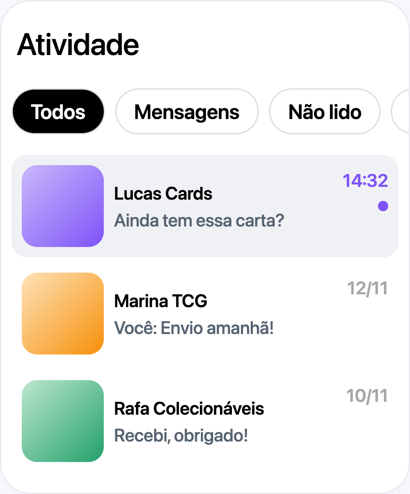

# Mensagens Diretas para Vendedores

## O que você vai aprender

Este guia explica como as mensagens diretas (DMs) funcionam para vendedores na Jamble. Você vai aprender como acessar suas mensagens, se comunicar com compradores sobre produtos e pedidos, enviar fotos e organizar sua caixa de entrada. As DMs são seu principal canal de comunicação com compradores fora das lives.

## Antes de começar

Você precisa de:
- Uma conta de vendedor aprovada na Jamble

## Onde encontrar suas mensagens

Todas as suas conversas ficam na aba **Atividade**, uma das abas principais na parte inferior da tela. No topo da tela Atividade você vê os filtros e, logo abaixo, a lista de conversas:

O filtro **Todos** vem selecionado. Uma conversa com mensagem nova aparece com **fundo cinza**, horário em roxo e um **ponto roxo** à direita.

Deslize os filtros para o lado para ver todos:

- **Todos**: todas as suas conversas
- **Mensagens**: conversas que não são de um pedido, como perguntas e ofertas sobre seus produtos
- **Não lido**: conversas com mensagens novas que você ainda não leu
- **Compras**: conversas sobre pedidos que você comprou de outros vendedores
- **Vendas**: conversas sobre pedidos que você vendeu
- **Arquivadas**: conversas que você arquivou (no iPhone, esse filtro aparece como **Concluído**)

Como vendedor, use **Mensagens** para responder perguntas antes da compra e **Vendas** para acompanhar os pedidos já feitos.

Para encontrar uma conversa específica, toque na **lupa** no topo da tela Atividade e busque por nome, produto, número do pedido ou mensagem.

## Tipos de conversas

Nem todas as conversas são iguais. Existem três tipos:

### Mensagens diretas

Quando alguém toca em **Mensagem** no seu perfil, abre uma conversa simples entre vocês dois, sem produto ou pedido vinculado.

### Conversas de produto

Quando um comprador te envia uma mensagem a partir de um produto da sua loja, ou faz uma oferta em um produto, a conversa mostra **o produto no topo**. Você pode tirar dúvidas sobre o produto e responder à oferta do comprador nessa mesma conversa.

### Conversas de pedido

Depois de uma venda, uma conversa com o comprador aparece automaticamente com os **detalhes do pedido**. Se vocês já conversavam sobre aquele produto da loja, o pedido é adicionado à mesma conversa. É aqui que você combina o envio e responde perguntas depois da venda.

Dependendo da etapa do pedido, a conversa mostra botões de ação ligados a esse pedido.

## Como iniciar uma conversa

### Enviar mensagem primeiro

Você pode enviar mensagem para outro usuário da Jamble:

1. Acesse o **perfil** da pessoa
2. Toque no botão **Mensagem** (ao lado do botão **Seguir**)
3. Digite sua mensagem e envie

Se você já conversou com essa pessoa, a conversa existente abre. Se não, uma nova conversa é criada quando você envia a primeira mensagem.

### Conversas automáticas

Você nem sempre precisa iniciar uma conversa. Uma conversa aparece na sua aba Atividade quando:

- Um comprador **te envia uma mensagem** sobre um produto da sua loja
- Um comprador **faz uma oferta** em um produto seu
- Um comprador **compra** de você

## O que você pode enviar

### Mensagens de texto

Digite uma mensagem de até **500 caracteres** e toque no botão de enviar. As mensagens são entregues em tempo real.

### Fotos

Toque no **ícone de foto** ao lado do campo de texto para enviar fotos:

- **No iPhone**: selecione até **6 fotos** da sua galeria
- **No Android**: selecione até **10 fotos** da sua galeria, ou **tire uma foto** direto com a câmera

Fotos são úteis para mostrar detalhes do produto, embalagem ou responder perguntas dos compradores sobre o estado do item.

### O que você não pode enviar

As DMs aceitam apenas texto e fotos. Não é possível enviar áudios, vídeos ou arquivos.

## Organizando sua caixa de entrada

### Indicadores de não lido

Quando você tem mensagens não lidas:
- Um **número** aparece na aba Atividade
- A conversa não lida aparece com **fundo cinza** e um **ponto roxo** ao lado

### Arquivando conversas

Para arquivar uma conversa que você não precisa no momento:

- **No iPhone**: pressione e segure a conversa na lista e toque em **Arquivar**
- **No Android**: deslize a conversa para a esquerda e toque em **Arquivar**

A conversa vai para o filtro **Arquivadas** (**Concluído** no iPhone). Para trazer de volta, abra esse filtro, faça o mesmo gesto na conversa e toque em **Desarquivar**.

### Excluindo uma mensagem

Se você enviou uma mensagem por engano:

1. **Pressione e segure** a mensagem que deseja excluir
2. Toque na opção de **excluir** a mensagem

A mensagem é removida da conversa. Você só pode excluir as suas próprias mensagens.

### Confirmação de leitura

Abaixo da sua última mensagem aparece o horário de envio. Quando a outra pessoa lê a mensagem, aparece um **ícone de leitura** ao lado do horário.

## Notificações

Você recebe uma **notificação** para cada nova mensagem em uma conversa privada. A notificação mostra:

- O nome de quem enviou
- O texto da mensagem (ou "Te enviou uma foto" para mensagens com foto)
- A imagem do produto, se a conversa é sobre um produto

Toque na notificação para ir direto para aquela conversa.

Se você não está recebendo notificações, verifique se as notificações estão ativadas para a Jamble nas configurações do seu celular e se a opção **Mensagens** está ativada nas configurações de notificação do app.

## Segurança nas conversas

- **Mantenha as conversas dentro da Jamble.** Mensagens com dados pessoais, como telefone ou email, ou com convites para continuar a conversa em outras plataformas, são bloqueadas e não chegam ao comprador
- **Mensagens ofensivas também são bloqueadas.** Converse sempre com respeito
- **Usuários bloqueados não podem te enviar mensagens.** Se alguém estiver sendo inconveniente, abra o perfil da pessoa, toque no menu de opções e escolha **Bloquear**

## Dicas importantes

- **Responda rápido às perguntas dos compradores.** Respostas rápidas constroem confiança e podem fazer a diferença entre uma venda e um comprador perdido
- **Use os filtros Mensagens e Vendas.** Eles separam as perguntas antes da compra das conversas sobre pedidos
- **Envie fotos para responder perguntas.** Se um comprador pergunta sobre o estado do produto, uma foto rápida resolve
- **Confira suas conversas arquivadas de vez em quando.** Você pode ter arquivado uma conversa que depois precisa de acompanhamento, como um problema de envio

## Perguntas frequentes

**Compradores podem me enviar mensagens antes de comprar algo?**
Sim. Um comprador pode tocar em **Mensagem** no seu perfil ou te enviar uma mensagem a partir de um produto da sua loja, mesmo que nunca tenha comprado de você.

**Eu recebo uma conversa para cada venda automaticamente?**
Sim. Depois de cada venda, uma conversa com o comprador aparece com os detalhes do pedido.

**Posso enviar mensagem para todos os meus compradores ao mesmo tempo?**
Não. A Jamble não tem um recurso de mensagem em massa. Você envia mensagens para cada comprador na conversa dele.

**Consigo ver se o comprador leu minha mensagem?**
Sim. Quando a outra pessoa lê sua última mensagem, aparece um ícone de leitura ao lado do horário.

**Qual a diferença entre o chat da live e as DMs?**
O chat da live é público: todos na live veem as mensagens. As DMs são privadas: apenas você e a outra pessoa veem a conversa. Use as DMs para falar com um comprador específico.

**As DMs estão disponíveis no iPhone e no Android?**
Sim. As mensagens funcionam nas duas plataformas. Alguns detalhes mudam, como o limite de fotos por envio e o gesto para arquivar uma conversa.

## Precisa de ajuda?

Entre em contato pelo chat do app ou envie um email para support@jambleapp.com.
