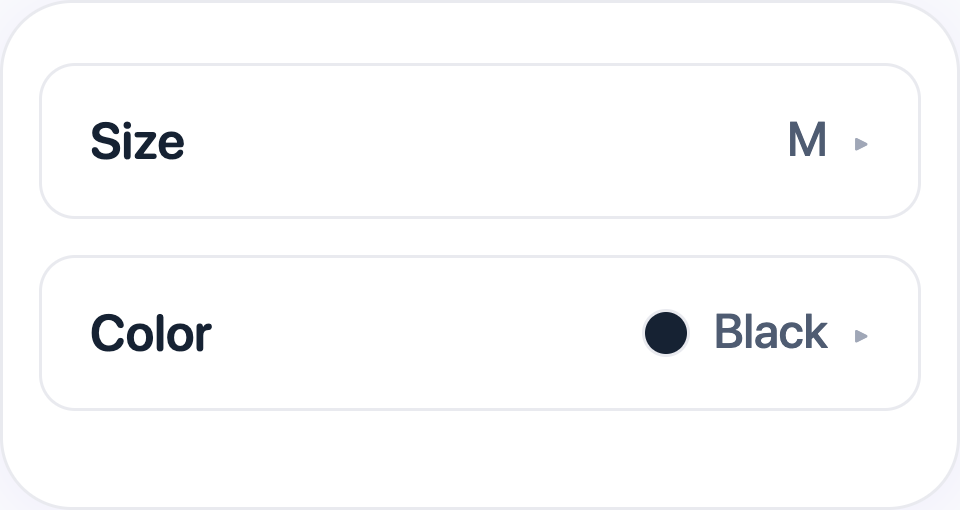
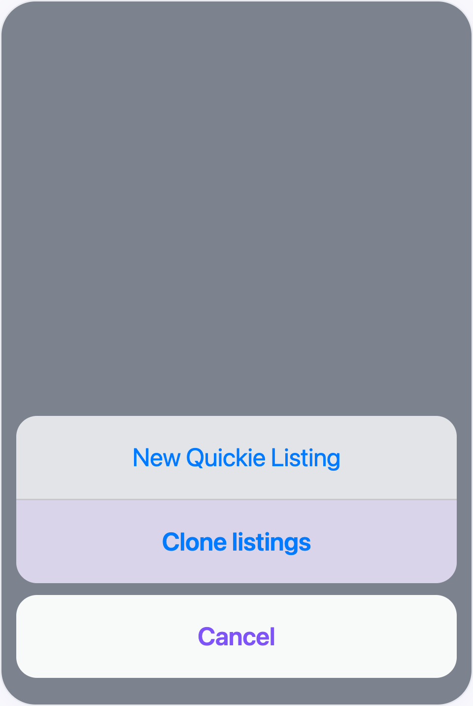
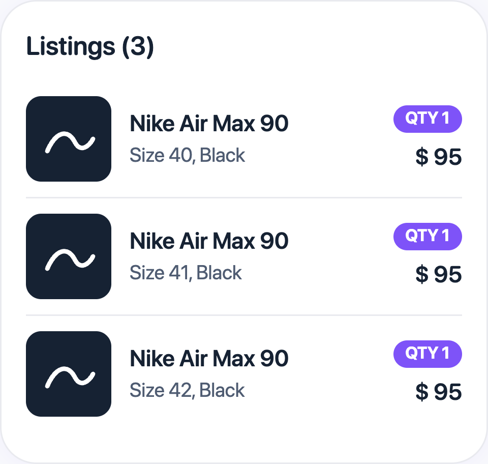

# Variants for Sellers, Sizes and Colors

## What you'll learn

How size and color work when listing products on Jamble, and how to sell the same item in several sizes or colors with the **Clone listings** option.

## Before you start

You need:

- An approved seller account on Jamble
- A live with products to list

## The main rule: one product, one size, one color

On Jamble, each listing has **one size** and **one color**. There is no "variants" field in the app, and no way to mark several sizes in the same listing.

If you sell the same item in more than one size or color, create **one listing for each combination**. For example, a T-shirt in sizes S, M and L becomes three listings, each with its own price, photos, quantity, **Size** and **Color**.

Most collectibles, such as cards and diecast models, have no size or color. In those cases, you don't need to worry about this rule.

## Where size and color show up in the form

In fashion categories, such as clothing and footwear, the product creation form shows the **Size** and **Color** fields once you choose the item's category.

Tap each field to choose. The **Size** options depend on the category (for example, S, M and L for T-shirts, or shoe sizes for footwear). For **Color**, you pick from the list of colors.

## Set the listing quantity

The **Quantity** field sets how many **identical** units the listing has, with the same size and the same color.

If you have 5 size S T-shirts in the same color, create one listing with quantity 5. If the 5 T-shirts are in different sizes, you need 5 separate listings, each with quantity 1.

## List the same item in several sizes

Example: you have a Nike Air Max in sizes 40, 41 and 42, all in black.

You need 3 listings. To avoid typing the same details three times, use **Clone listings** in the live's add-products menu.

Step by step:

1. Create the first complete listing (photos, title, description, price, **Quantity**, **Size** 40 and **Color**).
2. In your next live, or in the same live, open the add-products menu and tap **Clone listings** to bring in a copy of the listing.
3. In the copy, change only the **Size** and the title. Save.
4. Repeat for sizes 41 and 42.

The copy brings the photos, description, price, category and other details of the original listing. You only change what needs to be different, in this case, the size. See more in [Duplicate (Clone) Products](https://intercom.help/jamble-bb4bea116bbe/en/articles/14288110).

## The result: several listings of the same item in the live

In the live, the three sizes show up as three different products in your list. Buyers choose the one that fits them, and the size of each product shows during the sale.

Each listing has its own quantity. When a unit sells, that listing's quantity goes down. When it reaches zero, only that size is sold out, without affecting the others.

## Important tips

- **Put the size in the title.** Buyers look quickly during a live. "Nike Air Max 90, 42, black" is clear right away
- **Use Multi for items with several colors.** If the item has more than one main color, such as a printed T-shirt, choose **Multi** instead of a single color
- **Use One Size for universal items.** Caps, bags and most accessories use **One Size**
- **Use Other Size when yours is not in the list.** Choose **Other Size** and put the exact size in the title or description
- **Review the copy before publishing.** The copy keeps everything from the original. Check the photo, price and size before saving

## Frequently asked questions

**Can I put several sizes in the same listing?**
No. Each listing has one size. If you have the same item in several sizes, create one listing for each size. Use **Clone listings** to save time.

**Can I choose several colors in the same listing?**
No. Each listing has one color. If the item has several colors, choose **Multi**.

**Why don't I see the Size field?**
The **Size** field shows up in fashion categories, such as clothing and footwear, once you choose the item's category. In categories like cards and collectibles, it doesn't show up.

**Are size and color required?**
No, but we recommend filling them in. Buyers use this information to decide.

## Need help?

Contact our support team in the app, under Profile > Settings > Contact customer support.
