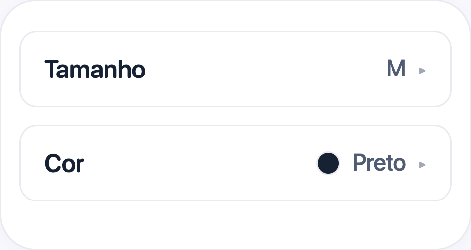
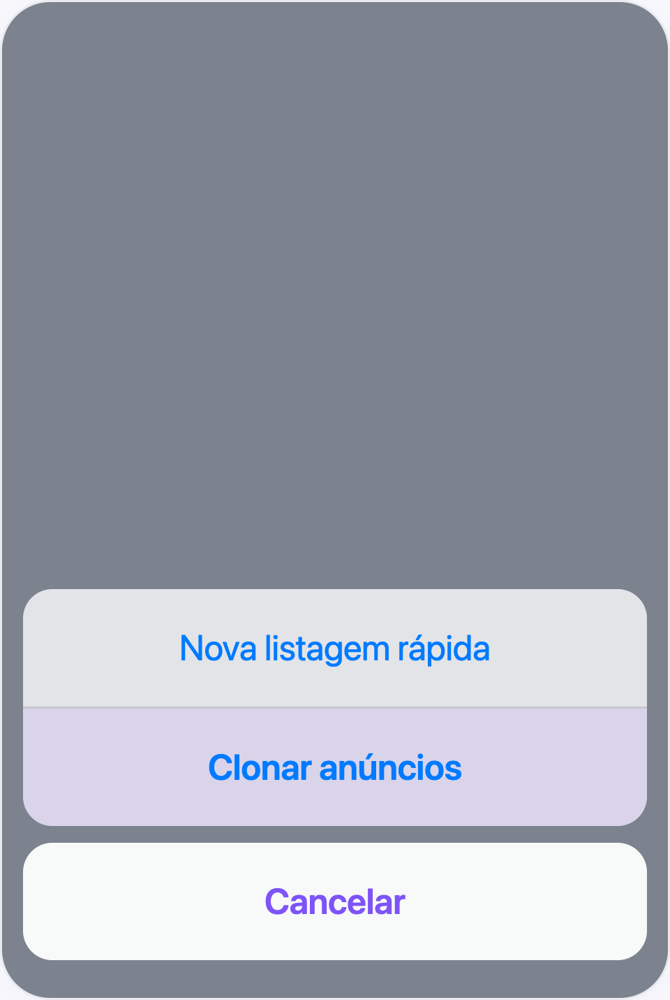
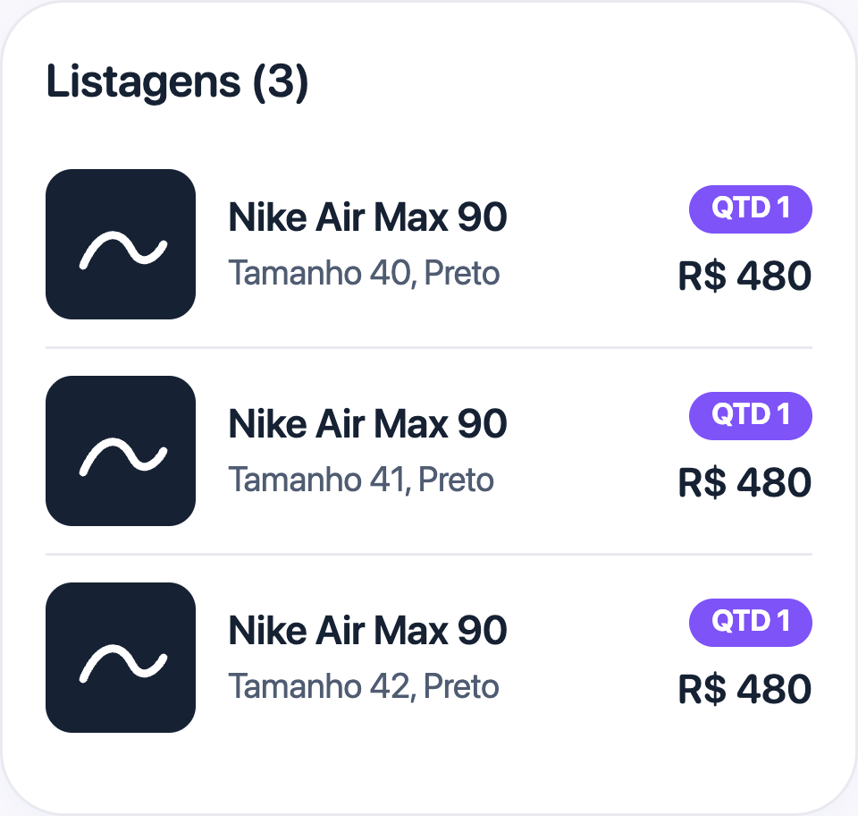

# Variantes para Vendedores, Tamanhos e Cores

## O que você vai aprender

Como tamanho e cor funcionam ao listar produtos na Jamble, e como vender o mesmo item em vários tamanhos ou cores usando a opção **Clonar anúncios**.

## Antes de começar

Você precisa de:

- Uma conta de vendedor aprovada na Jamble
- Uma live com produtos para listar

## A regra principal: um produto, um tamanho, uma cor

Na Jamble, cada anúncio tem **um tamanho** e **uma cor**. Não existe um campo de "variantes" no app, nem uma forma de marcar vários tamanhos no mesmo anúncio.

Se você vende o mesmo item em mais de um tamanho ou cor, crie **um anúncio para cada combinação**. Por exemplo, uma camiseta nos tamanhos P, M e G vira três anúncios, cada um com seu próprio preço, fotos, quantidade, **Tamanho** e **Cor**.

A maioria dos colecionáveis, como cartas e miniaturas, não tem tamanho nem cor. Nesses casos, você não precisa se preocupar com esta regra.

## Onde tamanho e cor aparecem no formulário

Nas categorias de moda, como roupas e calçados, o formulário de criação do produto mostra os campos **Tamanho** e **Cor**, depois que você escolhe a categoria do item.

Toque em cada campo para escolher. As opções de **Tamanho** dependem da categoria (por exemplo, P, M e G para camisetas, ou a numeração para calçados). Em **Cor**, você escolhe na lista de cores.

## Definir a quantidade do anúncio

O campo **Quantidade** define quantas unidades **idênticas** o anúncio tem, com o mesmo tamanho e a mesma cor.

Se você tem 5 camisetas P da mesma cor, faça um anúncio com quantidade 5. Se as 5 camisetas têm tamanhos diferentes, você precisa de 5 anúncios separados, cada um com quantidade 1.

## Listar o mesmo item em vários tamanhos

Exemplo: você tem um Nike Air Max nos tamanhos 40, 41 e 42, todos na cor preta.

Você precisa de 3 anúncios. Para não digitar os mesmos detalhes três vezes, use **Clonar anúncios** no menu de adicionar produtos da live.

Passo a passo:

1. Crie o primeiro anúncio completo (fotos, título, descrição, preço, **Quantidade**, **Tamanho** 40 e **Cor**).
2. Na live seguinte, ou na mesma live, abra o menu de adicionar produtos e toque em **Clonar anúncios** para trazer uma cópia do anúncio.
3. Na cópia, mude só o **Tamanho** e o título. Salve.
4. Repita para os tamanhos 41 e 42.

A cópia traz as fotos, a descrição, o preço, a categoria e os outros detalhes do anúncio original. Você só muda o que precisa ser diferente, no caso, o tamanho. Veja mais em [Duplicar (Clonar) Produtos](https://intercom.help/jamble-bb4bea116bbe/pt-BR/articles/14288110).

## O resultado: vários anúncios do mesmo item na live

Na live, os três tamanhos aparecem como três produtos diferentes na sua lista. Os compradores escolhem o que serve para eles, e o tamanho de cada produto aparece durante a venda.

Cada anúncio tem a sua própria quantidade. Quando uma unidade é vendida, a quantidade daquele anúncio diminui. Quando chega a zero, só aquele tamanho fica esgotado, sem afetar os outros.

## Dicas importantes

- **Coloque o tamanho no título.** Os compradores olham rápido durante a live. "Nike Air Max 90, 42, preto" fica claro na hora
- **Use Colorido para itens com várias cores.** Se o item tem mais de uma cor principal, como uma camiseta estampada, escolha **Colorido** em vez de uma cor só
- **Use Tamanho único para itens universais.** Bonés, bolsas e a maioria dos acessórios usam **Tamanho único**
- **Use Outros tamanhos quando o seu não está na lista.** Escolha **Outros tamanhos** e coloque o tamanho exato no título ou na descrição
- **Revise a cópia antes de publicar.** A cópia mantém tudo do original. Confira foto, preço e tamanho antes de salvar

## Perguntas frequentes

**Posso colocar vários tamanhos no mesmo anúncio?**
Não. Cada anúncio tem um tamanho. Se você tem o mesmo item em vários tamanhos, crie um anúncio para cada tamanho. Use **Clonar anúncios** para ganhar tempo.

**Posso escolher várias cores no mesmo anúncio?**
Não. Cada anúncio tem uma cor. Se o item tem várias cores, escolha **Colorido**.

**Por que não vejo o campo Tamanho?**
O campo **Tamanho** aparece nas categorias de moda, como roupas e calçados, depois que você escolhe a categoria do item. Em categorias como cartas e colecionáveis, ele não aparece.

**Tamanho e cor são obrigatórios?**
Não, mas recomendamos preencher. O comprador usa essas informações para decidir a compra.

## Precisa de ajuda?

Fale com o nosso suporte pelo app, em Perfil > Configurações > Contatar o suporte ao cliente.
